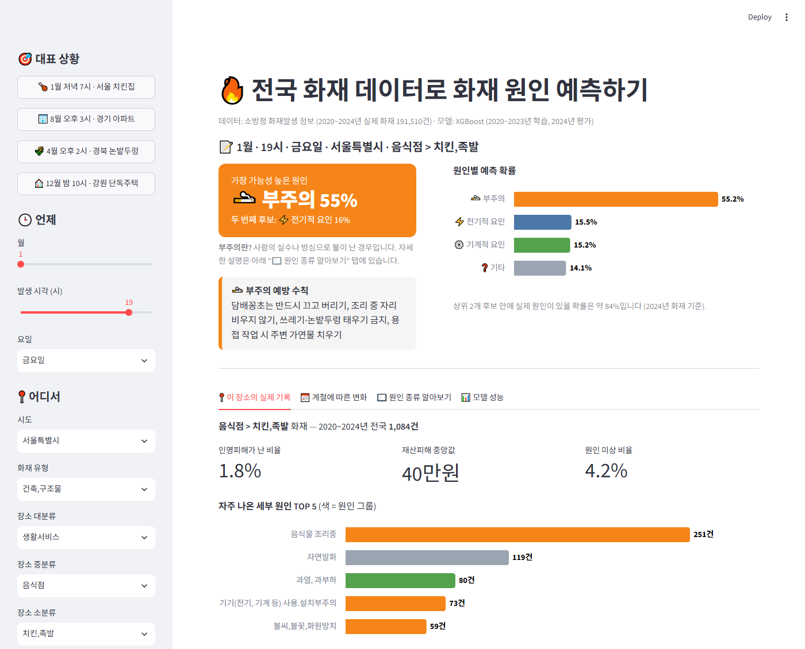
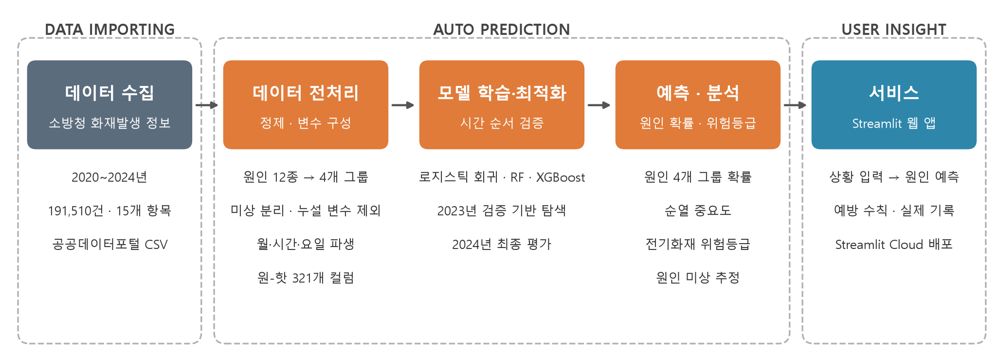
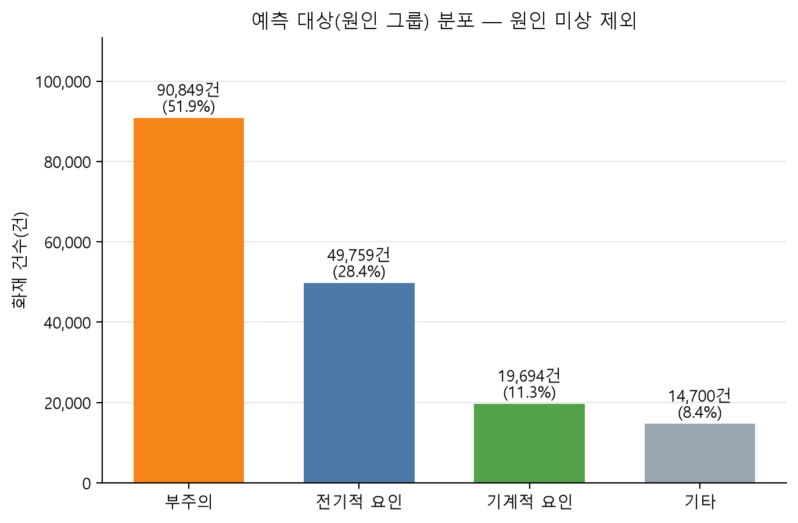
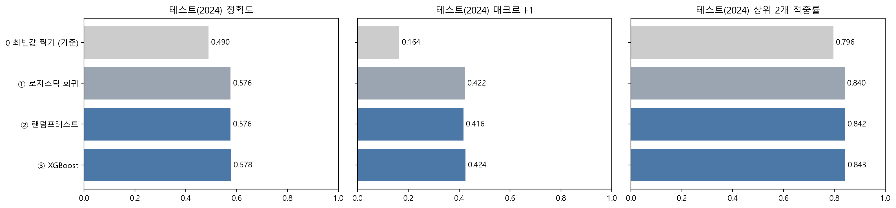
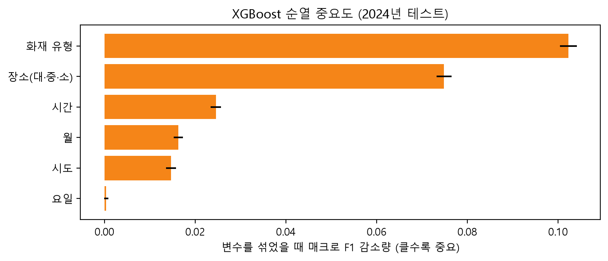
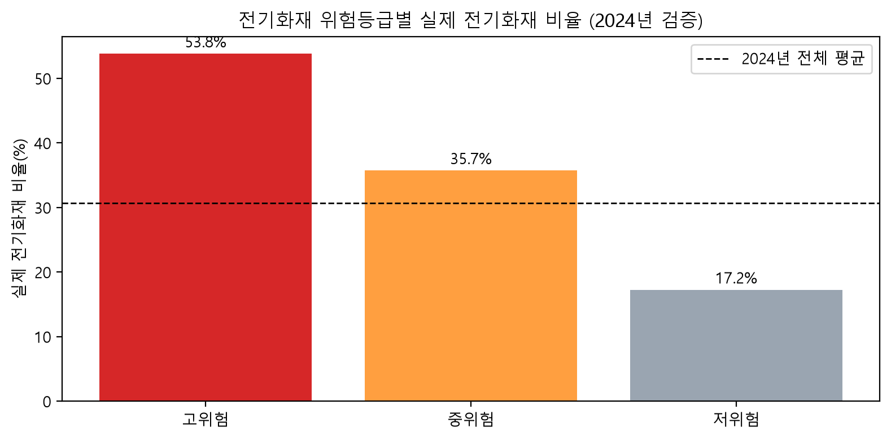
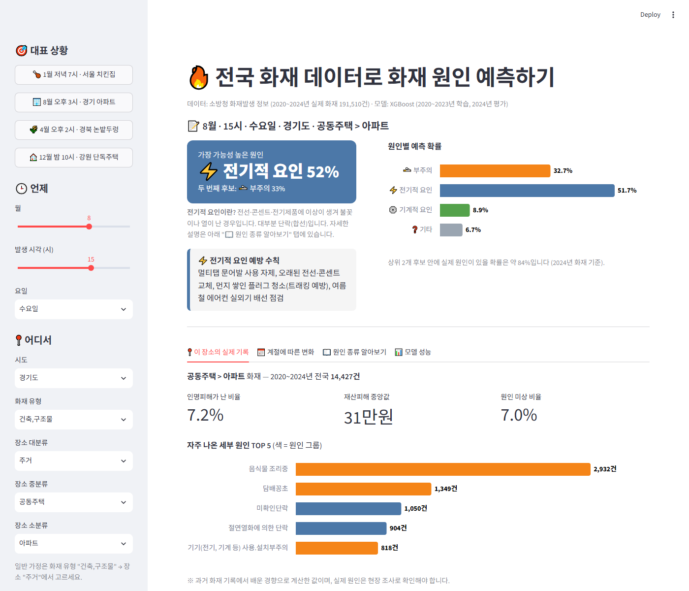

# 🔥 화재 원인 예측 AI

소방청 화재 데이터(2020~2024년, 191,510건)를 학습해 **언제·어디서·어떤 유형의 화재인지**만으로 화재 원인(부주의 · 전기적 요인 · 기계적 요인 · 기타)을 예측하는 머신러닝 프로젝트입니다.

**👉 웹 앱 바로가기: https://fire-cause-prediction-yzh0123.streamlit.app/**



<br>

## 1. 프로젝트 개요

| 항목 | 내용 |
|---|---|
| 목표 | 화재 발생 정보(시점·지역·장소·화재 유형)로 발화 원인 그룹 예측 |
| 데이터 | 공공데이터포털 [소방청_화재발생 정보](https://www.data.go.kr/data/15044003/fileData.do) (2020.1.1 ~ 2024.12.31, 191,510건) |
| 예측 대상 | 발화요인 12종 → 4개 그룹 (부주의 / 전기적 요인 / 기계적 요인 / 기타) |
| 최종 모델 | XGBoost (하이퍼파라미터 탐색 후 튜닝) |
| 서비스 | Streamlit 웹 앱 (Streamlit Community Cloud 배포) |
| 사용 기술 | Python · pandas · scikit-learn · XGBoost · Matplotlib · Altair · Streamlit |

### 활용 시나리오
- **화재 조사 보조**: 원인 확률이 높은 순서로 조사 우선순위 제시
- **예방 홍보**: 장소·시간대별로 많이 발생하는 원인과 예방 수칙 안내
- **원인 미상 화재 추정**: 원인을 밝히지 못한 16,508건의 원인 분포 추정

<br>

## 2. 분석 과정



### 데이터 전처리
- 원인 미상 16,508건은 학습에서 제외하고, 원인을 아는 **175,002건**으로 학습
- 입력 변수: 월 · 시간 · 요일 · 시도 · 화재 유형 · 장소(대·중·소분류)
- 발화요인 소분류, 인명·재산 피해처럼 **화재 이후에야 알 수 있는 정보는 입력에서 제외** (정답 누설 방지)
- 장소 소분류 364종 중 학습 기간 30건 미만은 '기타(드문 장소)'로 묶어 원-핫 인코딩 321개 컬럼 구성

### 예측 대상 분포


부주의가 절반 이상인 불균형 데이터라서, '부주의'로만 답해도 정확도가 약 49%가 나옵니다.
그래서 정확도와 함께 **매크로 F1 · ROC-AUC · 상위 2개 적중률**로 성능을 평가했습니다.

### 검증 방식
- **시간 순서 분할**: 2020~2023년으로 학습, **2024년으로 평가** (과거로 배워 미래를 맞히는 실제 사용 조건)
- 하이퍼파라미터 탐색도 2020~2022년 학습 / 2023년 검증으로 진행해 테스트 데이터를 미리 보지 않도록 함

<br>

## 3. 결과

### 모델 비교 (2024년 테스트 데이터)

| 모델 | 정확도 | 매크로 F1 | ROC-AUC |
|---|---|---|---|
| 최빈값 찍기 (기준) | 0.490 | 0.164 | 0.500 |
| 로지스틱 회귀 | 0.576 | 0.422 | 0.746 |
| 랜덤포레스트 | 0.576 | 0.416 | 0.747 |
| XGBoost | 0.578 | 0.424 | 0.748 |
| **XGBoost (튜닝, 최종)** | **0.581** | **0.429** | **0.750** |

- 찍기 기준보다 정확도 **약 9%p 향상**
- **상위 2개 적중률 84.3%**: 모델이 꼽은 원인 두 개 안에 실제 원인이 들어 있는 비율 → 조사 우선순위 보조 도구로 활용 가능



### 어떤 정보가 중요했나 (순열 중요도)


**화재 유형 > 장소 > 시간 > 월 > 시도 > 요일** 순으로 중요했고, 요일은 거의 영향이 없었습니다.

### 전기화재 위험등급
모델이 예측한 전기적 요인 확률로 2024년 화재를 3개 등급으로 나누면, 고위험 등급의 실제 전기화재 비율은 **53.8%**로 저위험(17.2%)의 약 3배입니다.



<br>

## 4. 웹 앱 기능

| 기능 | 설명 |
|---|---|
| 원인 예측 | 시점·지역·장소·화재 유형을 고르면 원인 4개 그룹의 확률 표시 |
| 예시 상황 | 치킨집 · 아파트 · 논밭두렁 · 강원 단독주택 버튼으로 바로 체험 |
| 실제 기록 | 같은 장소에서 실제로 발생한 화재의 인명피해 비율 · 재산피해 · 자주 나온 세부 원인 TOP 5 |
| 계절 변화 | 같은 상황에서 월별로 예측 원인이 어떻게 달라지는지 표시 |
| 원인 종류 알아보기 | 원인 그룹별 실제 사례와 예방 수칙 안내 |
| 모델 성능 | 2024년 테스트 성능과 기준 모델 비교 |



<br>

## 5. 한계와 개선 방향
- 입력이 시점·장소·화재 유형뿐이라 같은 조건에서도 원인이 다양해 정확도에 한계가 있음 → 건물 연식, 전기설비 정보 등 추가 데이터 결합 필요
- '기타' 그룹은 방화·자연적 요인·교통사고 등 성격이 다른 원인이 섞여 예측이 어려움
- 원인 미상 화재 추정은 '미상 화재도 원인을 아는 화재와 같은 패턴을 따른다'는 가정에 기반함

<br>

## 6. 파일 구성

```
├── app.py                      # Streamlit 웹 앱
├── fire_cause_project.ipynb    # 데이터 분석 · 모델 학습 전 과정 노트북
├── make_dataset.py             # 원본 CSV(cp949) → 분석용 CSV(UTF-8) 변환
├── make_profile.py             # 데이터 프로파일링 리포트 생성
├── requirements.txt
├── dataset/
│   └── fire_2020_2024.csv      # 분석용 데이터
├── model/
│   └── fire_cause_model.pkl    # 학습된 XGBoost 모델
└── images/                     # README 이미지
```

## 7. 실행 방법

```bash
pip install -r requirements.txt
streamlit run app.py
```

<br>

---
데이터 출처: 소방청, 「화재발생 정보」, 공공데이터포털 (이용허락범위 제한 없음)
